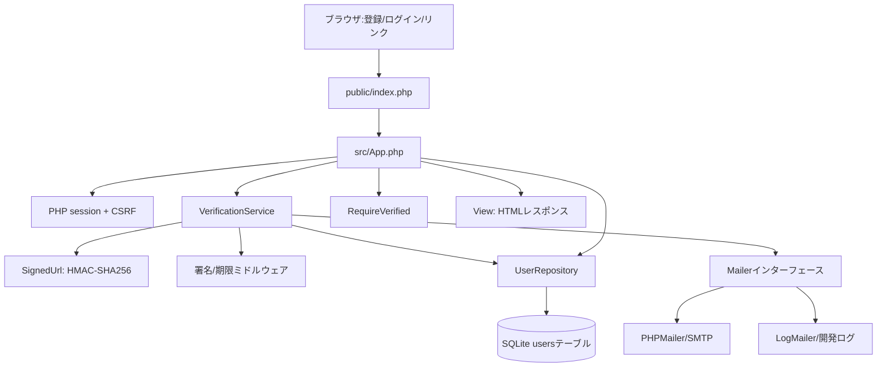

# 01 — 設計と構造

## 全体アーキテクチャ

## フォルダーと主要ファイルの責務

| ファイル | 主たる責務 | 依存する要素 |
|---|---|---|
| `public/index.php` | session開始、起動時の依存関係組立て、HTTPレスポンス送信 | Config、PDO、App、Mailer、SignedUrl |
| `public/router.php` | PHP組み込みサーバーの公開静的ファイル処理 | `index.php` |
| `src/App.php` | ルーティングと入力検証、登録、ログイン、再送、画面遷移 | UserRepository、VerificationService、View、CSRF |
| `src/View.php` | HTML生成、ユーザー文字列のエスケープ | CSRF |
| `src/Security/SignedUrl.php` | 正規化、URL組立て、HMAC作成、署名比較 | PHP標準暗号API |
| `src/Service/VerificationService.php` | メール送信とリンク検証の業務フロー | UserRepository、Mailer、SignedUrl、ミドルウェア |
| `src/Persistence/SqliteUserRepository.php` | ユーザーの検索・保存・認証列更新・再送枠管理 | PDO、SQLite |
| `src/Mail/PhpMailerAdapter.php` | SMTPによる実メール配送 | PHPMailer（Composer） |
| `src/Mail/LogMailer.php` | 開発時にURLを非公開ファイルへ追記 | ファイルシステム |
| `src/Http/Middleware/*.php` | 署名、期限、閲覧権限を判定 | SignedUrl / ユーザー状態 |

## 設計判断と背景

**Controller / Service / Repository分離**：HTTPの知識を`App`へ、認証手順を`VerificationService`へ、DB操作をRepositoryへ分けることで、DB・SMTPなしのテストが可能になります。すべてを1ファイルへ詰める設計に比べ、依存先を明確にできます。

**HMACとSHA-256ハッシュの役割の違い**：`user`はメールアドレスをSHA-256でハッシュした識別補助値です。メールの所有を直接証明するものではありません。真正性（変更されていないこと）は秘密鍵を使ったHMAC署名が担保します。単純なハッシュだけでは誰でもURLを組み替えられます。

**DBアクセスの原子性**：メールアドレスの変更と検証処理が同時に起きる可能性を考慮し、照合から更新まで`BEGIN IMMEDIATE TRANSACTION`で保護します。

**再送制限**：60秒のクールダウンはDB内に保存し、ページ更新や複数セッションで容易に解除できない設計です。認証前のメールアドレス変更では再送時刻を消しません。

**ブラウザとサーバーの境界**：HTMLフォームは入力値をPOSTで送り、サーバー側で入力チェックとセッション判定を実施します。クライアント側のフォーム制約だけでは安全性を確保できません。

## ファイル間の呼び出し順

`public/index.php` → `App::handle` → `App::register` → `UserRepository::create` → `VerificationService::sendVerificationEmail` → `SignedUrl::make` → `Mailer::sendVerificationEmail`。

リンクアクセスは`App::verify` → `VerificationService::verify` → `ValidateSignature::passes` → `ValidateExpiration::passes` → `SqliteUserRepository::markVerifiedIfEmailMatches`です。

図は処理の依存関係を示しています。`tests/FakeUserRepository.php`と`tests/FakeMailer.php`は永続化・送信に代わるテスト用の実装であり、本番のソースコードと依存関係を共通化しています。
