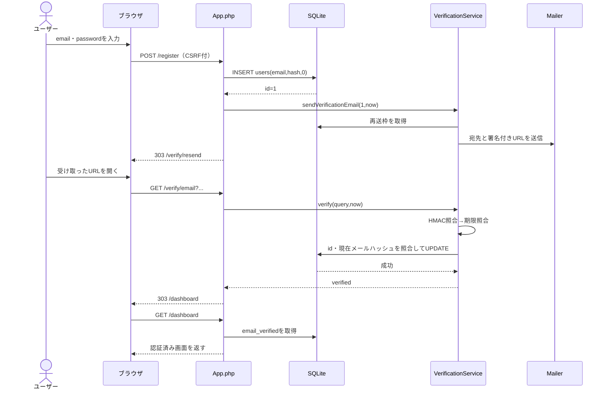

# 03 — 実行フローを時系列で追う

## 1. 登録→メール発行→確認→閲覧

## 2. 具体的な変数の変化

例：ユーザー`alice@example.com`を`id=7`で登録し、時刻を`1,790,000,000`（UNIX秒）と仮定します。

| 段階 | 値 / 判定 | 意味 |
|---|---|---|
| 登録直後 | `id=7, email_verified=0` | ログインは可能だが保護ページに入れない |
| 署名生成 | `user=SHA256("alice@example.com")` | 宛先メールのダイジェスト |
| 有効期限生成 | `expiration=1790001800` | 現在時刻より30分後 |
| 署名生成 | `signature=HMAC_SHA256("/verify/email?id=7&user=...&expiration=...", APP_KEY)` | 情報の改竄防止 |
| リンクを開いたとき | `now=1790000300` | 期限より前なので通過 |
| DB照合 | `sha256(DB.email) === user` | 現在の登録メールに対するリンク |
| DB更新 | `email_verified: 0 → 1` | 認証成立 |
| ダッシュボード | `email_verified=1` | `RequireVerified`が通過 |

`1790001800`は**説明用の例示値**です。実際のURLの`signature`は秘密鍵を持つサーバーのみが計算できます。

## 3. 異常系

| 状況 | 処理とHTTP応答 | 状態 |
|---|---|---|
| URLの`id`を変更 | HMAC不一致 → 403 | 未認証のまま |
| URLの`expiration`を延長 | HMAC不一致 → 403 | 未認証のまま |
| リンクを期限のちょうど1800秒後に開く | `expiration > now`を満たさず → 410 | 未認証のまま |
| 先にメールアドレス変更 | 署名が正しくても`user`とDB登録メールが不一致 → 403 | 未認証のまま |
| 未ログインで`/dashboard` | 303 `/login` | 未ログイン |
| ログイン済みだが未認証で`/dashboard` | 303 `/verify/resend` | 未認証 |
| 再送間隔が60秒未満 | DB更新が不成立、再送なし | 直近メールを利用 |
| SMTP送信失敗 | ログに記録、一般的なエラーを画面表示 | DB上は未認証、時間をおいて再送 |

## 4. メール変更時の詳細

初回に`alice@example.com`で送信し、ユーザーが認証する前に`alice2@example.com`へ変更すると、`email_verified=0`のままメールアドレスが置き換わります。送信枠が空くと、新アドレスへのURLが生成されます。この際、以前のURLに正しいHMACが付いていても、**現在のDB登録メールのハッシュ**と一致しないため認証できません。メールアドレスの現在値を参照する点が、単純な「有効期限内なら成功」とは異なります。
